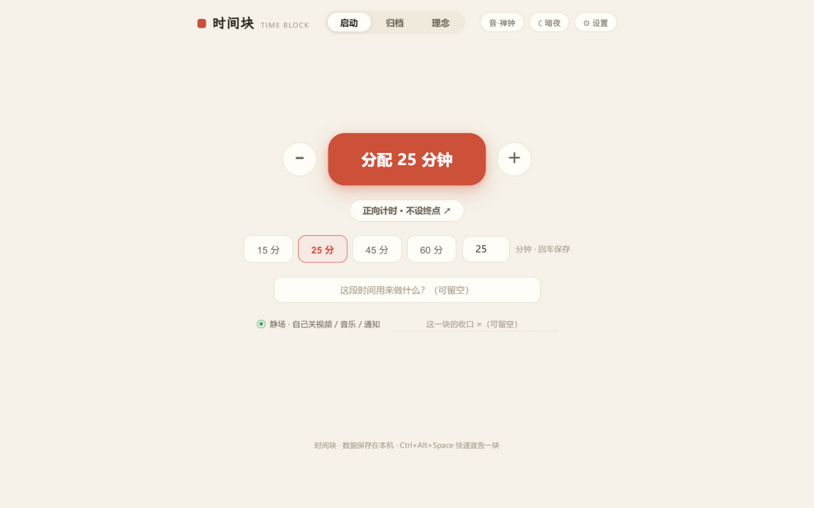
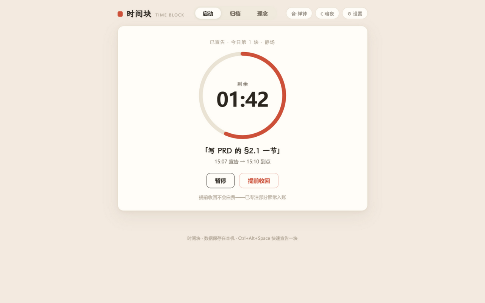
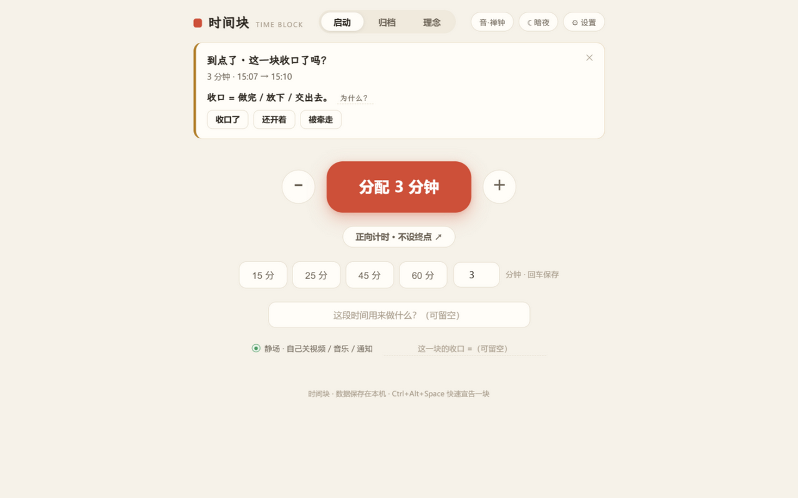
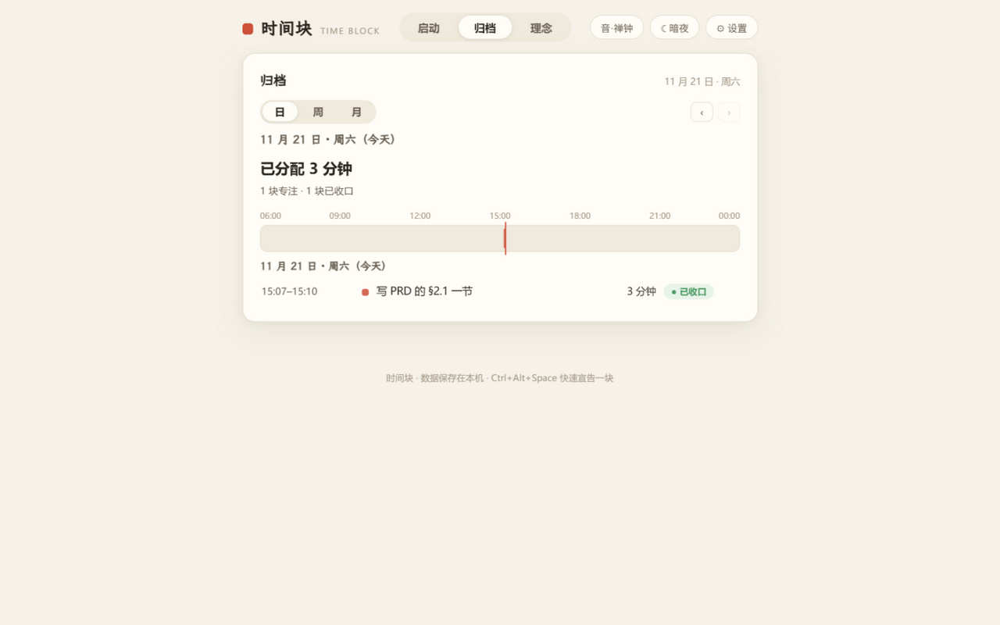
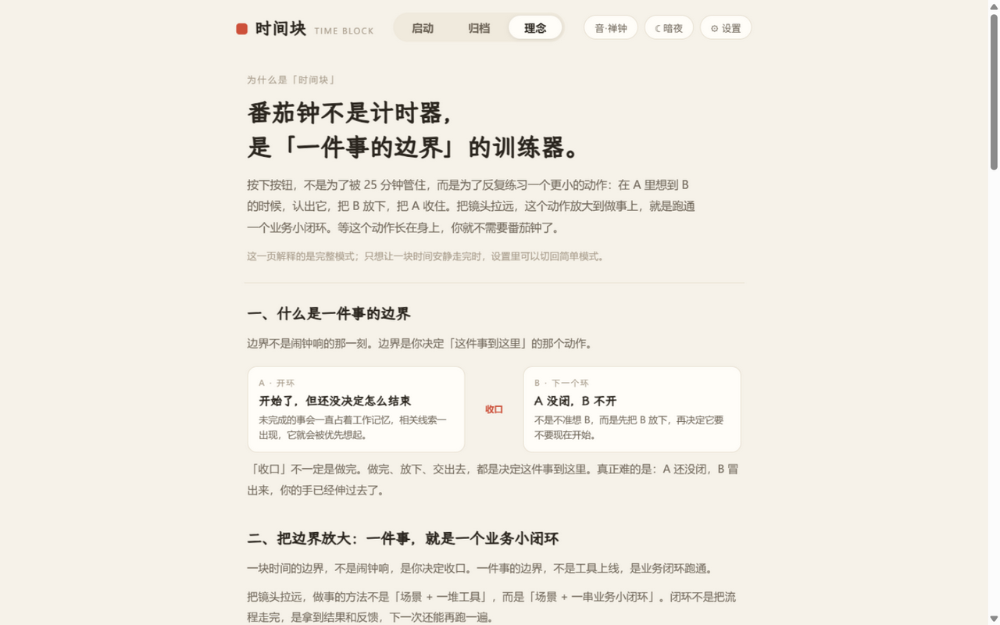

# 时间块 · Time Block

按下按钮，这块时间就有主了——一个把「分配一段时间给当下」做到极致的桌面专注计时器。

2026-11-10 起，它多了一层「闭环训练」：静场提醒、收口段、到点 ≠ 收口、线头、理念页。计时仍然不可协商，但「完成」由你决定。

完整产品设计见 [PRD.md](PRD.md)，任务追踪见 [ISSUES.md](ISSUES.md)。

## 界面

| 主界面 | 计时中 |
| :---: | :---: |
|  |  |
| **到点 ≠ 收口** | **归档** |
|  |  |
| **理念页** | **暗夜主题** |
|  |  |

## 现在就能用

| 方式 | 做法 |
| --- | --- |
| 桌面程序（推荐） | 双击 `app/dist/TimeBlock-0.1.4-portable.exe`（免安装），或运行 `TimeBlock-0.1.4-setup.exe` 安装；历史版本见 [Releases](https://github.com/cwenan/TimeBlock/releases) |
| 开发模式 | `cd app && npm start` |
| 浏览器原型 | 双击 `时间块.html`（无需安装，数据存浏览器 localStorage） |

## 使用

- **模式**：设置里切换「简单 / 完整」。简单只计时、到点即交付；完整含静场提醒、收口段、到点后问收口
- **启动**：大按钮分配一块时间；±5 步进调时长；15/25/45/60 为内置预设；在自定义框输入分钟数按回车，可保存为长期常用块（最多 4 个）
- **静场提醒**：每个新块提醒自己关掉视频 / 音乐 / 通知；软件不会替你关。启动页可单次按「有声」破例，设置里可改默认
- **收口定义**：启动页可写一句「这一块的收口 = …」，进行中会一直显示；可留空
- **收口段**：10 分钟以上的块，最后一段进度环变暖色并轻响一声「收口钟」，提示开始降落
- **到点 ≠ 收口**：时间到后先出回执问「这一块，收口了吗？」，选「收口了 / 还开着 / 被牵走」，之后才出现「再分配」
- **线头**：选「还开着」可留一句「还差哪一步」；下次启动只出现这一条，可接上或放下
- **正向计时**：不设终点，环随专注填充，随时「交付这块时间」（Shift+Enter）
- **过程**：暂停可冻结；提前收回需两步确认，已专注部分照常入账
- **归档**：日 / 周 / 月三种粒度，`‹ ›` 切换上一期，时间带与柱状图看时间流向；已收口 / 还开着 / 被牵走是记录（悬停看线头或来源），待收口的块在行内点「标记收口」补标记
- **理念（完整模式）**：顶栏「理念」页，围绕「一件事的边界」讲为什么这样设计，并把它放大到业务小闭环（业务没跑通，工具不进场）；可写自己的「立约」
- **全局快捷键**：`Ctrl+Alt+Space` 按上次参数直接宣告一块
- **提示音**：右上角循环切换 禅钟/温婉/鼓舞/沙铃/静音；主题：纸白 / 暗夜

## 桌面端集成（exe 版）

- 任务栏图标：**自然番茄铺满按钮**（透明底无画框），运行时用 Windows 原生角标 (`setOverlayIcon`) 叠加黄底剩余分钟数字，暂停变灰；进度条用 Windows 原生按钮底部那条（满→0 排空）+ **窗口标题即剩余时间**（任务栏按钮直接可读）
- 顶栏 ⚙ 设置：**开机自启**（启动文件夹快捷方式）、关闭与最小化到托盘开关
- 最小化 / 关闭窗口 = 收进系统托盘（首次有气泡提示），托盘左键恢复、右键退出
- 后台计时：窗口最小化或收进托盘后计时、标题、任务栏角标、进度条照常更新（关闭 Electron 后台节流）
- 系统休眠时自动按已专注时长结算
- 交付时弹 Windows 通知 + 提示音
- 单实例：重复启动唤起已有窗口

## 数据

- 桌面版数据存于 `%APPDATA%/timeblock`（Electron localStorage），本机留存，无账号无云同步
- 浏览器原型数据存于浏览器 localStorage（按域名隔离）
- 原版「番茄人生」`record.json` 的一键导入在 ISSUE #008 排期

## 目录

```
app/            Electron 工程（main.js / preload.js / index.html / build/icon.png）
app/dist/       打包产物（安装版 + 便携版 exe）
docs/           原版桌面版文案取证
PRD.md          产品需求文档
ISSUES.md       本地 issue 追踪
时间块.html     浏览器单文件原型（与桌面版同源）
```

## 打包

```bash
cd app
npm install        # 已装 electron + electron-builder
npm run dist       # 产出 NSIS 安装版 + 便携版
```

提示：便携版 exe 可能被杀毒软件误报（Electron 打包的通病），加入信任或使用安装版即可。
